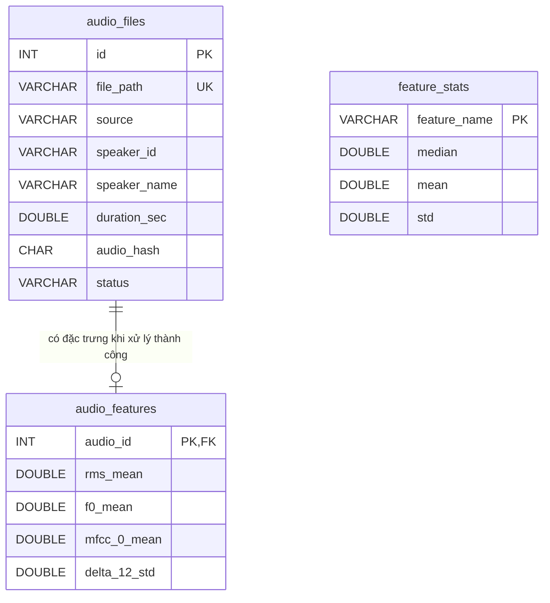
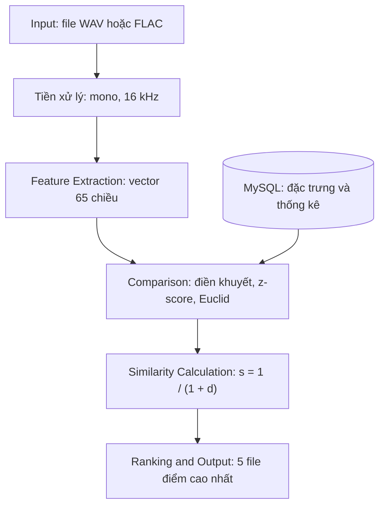

# PHẦN 3. TRIỂN KHAI TRÍCH RÚT ĐẶC TRƯNG VÀ XÂY DỰNG CƠ SỞ DỮ LIỆU

## 3.1. Mục tiêu và công cụ triển khai

Từ bộ dữ liệu giọng nói nam đã xây dựng ở phần 1, hệ thống chuyển mỗi bản ghi thành vector 65 chiều theo bộ đặc trưng phần 2. Các vector và thông tin mô tả được quản lý bằng MySQL, phục vụ tìm kiếm file âm thanh có đặc điểm giọng nói gần với một file truy vấn.

Kiến trúc được giữ đơn giản: chương trình Python thực hiện xử lý tín hiệu và so sánh; MySQL quản lý dữ liệu; Streamlit cung cấp giao diện demo. Không sử dụng mạng học sâu, API server riêng hoặc hệ quản trị vector.

| Thành phần | Công cụ | Vai trò |
|---|---|---|
| Đọc và ghi âm thanh | SoundFile 0.14.0 | Đọc WAV/FLAC, thông số lấy mẫu và kênh |
| Tính toán số | NumPy 2.5.4 | Chia khung, FFT, thống kê, chuẩn hóa, khoảng cách |
| Xử lý tín hiệu | SciPy 1.18.1 | Resample polyphase, cửa sổ Hann, DCT |
| Phân tích giọng nói | praat-parselmouth 0.4.7, Praat tích hợp 6.1.38 | F0, formant, HNR, jitter, shimmer |
| Kết nối CSDL | mysql-connector-python 26.10.0 | Truy vấn MySQL có tham số |
| Giao diện | Streamlit 1.67.0 | Upload, nghe âm thanh, xem bảng/biểu đồ |
| Môi trường | Python 3.14.7 trên Windows | Chạy chương trình cục bộ |

Năm file chính là `features.py`, `database.py`, `search.py`, `evaluate.py` và `app.py`. Dữ liệu gốc trong `Dataset voices/dataset_final` không bị thay đổi.

## 3.2. Tiền xử lý âm thanh

Các file bộ dữ liệu đã thống nhất WAV PCM16, mono, 16 kHz. Tuy nhiên, file truy vấn có thể có thông số khác, vì vậy dùng cùng quy trình đọc cho cả dữ liệu và truy vấn:

1. Kiểm tra nội dung/header thực, không chỉ dựa vào phần mở rộng. Hỗ trợ WAV/WAVEX hoặc FLAC, một hoặc hai kênh, thời lượng 1–60 giây, dung lượng tối đa 25 MiB.
2. Giải mã mẫu về số thực. Với stereo, lấy trung bình hai kênh để tạo mono.
3. Nếu tần số lấy mẫu khác 16 kHz, dùng `scipy.signal.resample_poly` đổi về 16 kHz.
4. Không chuẩn hóa biên độ riêng từng file, không khử nhiễu và không cắt/nối các khoảng lặng. Những thao tác đó có thể làm thay đổi RMS, tỷ lệ khoảng lặng và các đặc trưng chất lượng giọng nói.
5. Từ chối file lỗi, mẫu không hữu hạn, file im lặng hoàn toàn hoặc có dưới 0,5 giây quan sát hữu thanh hợp lệ. Bản ghi dưới 3 giây có cảnh báo; nên dùng đoạn nói từ khoảng 6 giây để lấy được nhiều quan sát hơn.

Tỷ lệ khoảng lặng được tính trước mọi loại bỏ khung khỏi các phép đo khác. Hệ thống không tự xác minh người nói là nam hoặc bảo đảm chỉ có một người nói; đây là điều kiện của dữ liệu/đầu vào, không phải chức năng của thuật toán tìm kiếm.

## 3.3. Triển khai bộ đặc trưng 65 chiều

### 3.3.1. Quy tắc chia khung

Với tín hiệu 16.000 mẫu/giây, chọn khung 25 ms tương ứng 400 mẫu, bước 10 ms tương ứng 160 mẫu. Không đệm để căn giữa; phần cuối chưa đủ 400 mẫu không tạo thêm khung. RMS và ZCR được tính trên mẫu chưa nhân cửa sổ. Đặc trưng phổ và MFCC dùng cửa sổ Hann tuần hoàn và FFT 512 điểm trên chính các khung đó.

Nếu tín hiệu có N mẫu thì số khung là:

\[
T=1+\left\lfloor\frac{N-400}{160}\right\rfloor.
\]

Các phép đo Praat có cửa sổ ước lượng riêng. Bước lấy quan sát được đặt 10 ms, nhưng không khẳng định cửa sổ cao độ/formant giống cửa sổ FFT. Các chuỗi được đối chiếu theo thời gian, không ghép theo chỉ số mảng một cách máy móc.

### 3.3.2. Thứ tự và cách trích rút

| Vị trí (từ 1) | Đặc trưng | Cách triển khai | Số chiều |
|---|---|---|---:|
| 1–2 | RMS mean, std | Căn trung bình bình phương mẫu mỗi khung | 2 |
| 3–4 | ZCR mean, std | Đếm cặp mẫu liên tiếp có tích âm, chia 399; cặp chứa mẫu 0 không tự tính là đổi dấu | 2 |
| 5 | Silence ratio | Số khung RMS ≤ 0,01 chia tổng số khung | 1 |
| 6–8 | F0 mean, std, range | Praat autocorrelation, chỉ quan sát F0 hữu thanh hợp lệ | 3 |
| 9–14 | F1, F2, F3 mean/std | Praat Burg, lấy ba formant đầu ở thời điểm hữu thanh | 6 |
| 15–16 | HNR mean/std | Praat harmonicity cross-correlation | 2 |
| 17–18 | Jitter local, shimmer local | Chuỗi xung Praat; đo thay đổi chu kỳ và biên độ liên tiếp | 2 |
| 19–20 | Spectral centroid mean/std | Trọng tâm phổ dùng công suất làm trọng số | 2 |
| 21–22 | Spectral bandwidth mean/std | Căn phương sai tần số có trọng số công suất | 2 |
| 23–24 | Spectral rolloff mean/std | Bin đầu đạt ít nhất 85% công suất tích lũy | 2 |
| 25–26 | Spectral flux mean/std | Euclid giữa phổ công suất chuẩn hóa của hai khung kề nhau | 2 |
| 27–52 | MFCC c0–c12 mean/std | 40 bộ lọc Mel, log, DCT-II; mỗi hệ số lưu mean rồi std | 26 |
| 53–65 | Delta c0–c12 std | Hồi quy W=2 trên chuỗi MFCC, sau đó lấy std | 13 |
| | **Tổng** | | **65** |

Mọi độ lệch chuẩn dùng `ddof=0`, với mẫu số là số quan sát hợp lệ của từng chuỗi, không nhất thiết bằng số khung FFT. Tỷ lệ, jitter và shimmer lưu dưới dạng phần số, không nhân 100 trong CSDL.

**Nhóm phổ.** Đặt \(P_k(j)=|X_k(j)|^2\), \(p_k(j)=P_k(j)/\sum_jP_k(j)\). Khi tổng công suất dương:

\[
C_k=\sum_j f_jp_k(j),\qquad B_k=\sqrt{\sum_j(f_j-C_k)^2p_k(j)}.
\]

Rolloff là tần số thấp nhất đạt ngưỡng công suất tích lũy 85%. Flux được tính theo:

\[
F_k=\sqrt{\sum_j[p_k(j)-p_{k-1}(j)]^2}.
\]

Không tính moment phổ cho khung tổng công suất bằng 0. Chỉ tính flux khi cả hai khung **liền kề ban đầu** có công suất dương; không xóa khung rồi nối qua khoảng trống. Khoảng lặng theo ngưỡng RMS vẫn chỉ là xấp xỉ năng lượng thấp, có thể nhầm giọng nhỏ và không loại hết tiếng nền.

**Nhóm MFCC.** Dùng Mel HTK \(m=2595\log_{10}(1+f/700)\), 40 tam giác cao 1 trước khi lấy mẫu, không chuẩn hóa diện tích. Log năng lượng là log tự nhiên với sàn \(10^{-10}\); DCT-II trực chuẩn giữ c0–c12. Không cắt dải động theo mức cực đại riêng của file. Đây là các quy ước công bố trong phần triển khai để bảo đảm tái lập; bản TXT phần 2 không giữ đầy đủ một số công thức.

Delta với W=2:

\[
\Delta c_{n,k}=\frac{(c_{n,k+1}-c_{n,k-1})+2(c_{n,k+2}-c_{n,k-2})}{10}.
\]

Ở biên, lặp vector đầu/cuối. Tính delta trên toàn chuỗi đúng thứ tự thời gian, kể cả các khung lặng, trước khi lấy std. Chuỗi thống kê không giữ lại toàn bộ trình tự phát âm, đây là hạn chế của cách biểu diễn gọn 65 chiều.

**Nhóm giọng nói.** `Sound.to_pitch_ac` dùng raw autocorrelation, bước 10 ms, pitch floor 50 Hz, ceiling 800 Hz, voicing threshold 0,45. Đây không phải filtered autocorrelation của phép khảo sát phần 1; không dùng số đo mới để khẳng định tái lập bảng F0 của phần đó. Formant Burg dùng tối đa 5 formant, trần 5.000 Hz, cửa sổ tham số 25 ms, pre-emphasis nội bộ từ 50 Hz. HNR cross-correlation dùng minimum pitch 50 Hz, silence threshold 0,1 và 1 chu kỳ/cửa sổ theo API Praat.

Hữu thanh được xác định từ F0 dương/hữu hạn. Mặt nạ hữu thanh ghép với formant/HNR bằng thời điểm gần nhất; HNR loại giá trị sentinel −200 dB của Praat. Không dùng F0=0 đại diện giọng trầm ở khung vô thanh.

Jitter/shimmer local được gọi từ PointProcess tạo bởi Sound và Pitch. Giới hạn chu kỳ 0,001–0,025 giây, hệ số chênh lệch chu kỳ tối đa 1,3 và biên độ tối đa 1,6. Jitter/shimmer không được thay bằng std của đường F0 hoặc RMS. Các thông số chi tiết được lưu trong `features.EXTRACTOR_SETTINGS` và kết quả xây CSDL.

### 3.3.3. Giá trị thiếu và chuẩn hóa

Một phép đo không xác định được lưu NULL, còn biểu diễn trong NumPy là NaN. Khi chuẩn bị tập tìm kiếm, tính median từng chiều từ các giá trị hợp lệ và dùng để điền khuyết. Sau đó tính mean và std trên tập đã điền:

\[
z_j=\frac{x_j^*-\mu_j}{\sigma_j},
\]

trong đó \(x_j^*\) là giá trị gốc hoặc median khi bị thiếu. Các tham số được lưu và giữ nguyên khi truy vấn. Chiều có std bằng 0 không giúp phân biệt trên gallery, nên gán z=0 cho cả dữ liệu và query; nếu toàn bộ gallery thiếu một chiều thì báo lỗi thay vì tự chế giá trị.

Trong demo, gallery là toàn bộ file đủ chất lượng. Trong thí nghiệm đánh giá, chỉ fit trên gallery của thí nghiệm, tuyệt đối không dùng query để ước lượng median/mean/std. Các thống kê đánh giá chỉ ở bộ nhớ, không thay bảng thống kê demo.

## 3.4. Thiết kế cơ sở dữ liệu MySQL

Dùng CSDL riêng `voice_similarity`, engine InnoDB, bộ ký tự utf8mb4. File âm thanh được lưu trên đĩa; CSDL lưu đường dẫn tương đối, không đưa WAV vào BLOB.

### 3.4.1. Các bảng

| Bảng | Trường quan trọng | Vai trò |
|---|---|---|
| `audio_files` | id (PK), file_path (UNIQUE), source, subset, speaker_id, speaker_name, gender | Quản lý vị trí và nhãn bản ghi |
| | duration_sec, sample_rate, channels, format, subtype, file_size_bytes | Thông số file theo manifest |
| | audio_hash, status, error_message | Nhận ra nội dung trùng và theo dõi lỗi |
| `audio_features` | audio_id (PK, FK), 65 cột DOUBLE cho phép NULL | Một hàng đặc trưng trên mỗi bản ghi hợp lệ |
| `feature_stats` | feature_name (PK), median, mean, std | 65 hàng tham số điền khuyết/chuẩn hóa |

`source + speaker_id` xác định nhãn người nói vì ID riêng lẻ thuộc các nguồn khác nhau. Không tách thêm bảng người nói vì phạm vi ứng dụng không có thao tác sửa hồ sơ người nói độc lập.



Sơ đồ chỉ minh họa một số cột đặc trưng để dễ đọc; bảng thật có đủ 65 cột. `feature_stats` liên hệ về mặt thuật toán qua tên đặc trưng, không phải một FK tới tên cột SQL. File lỗi vẫn có hàng metadata, không có hàng đặc trưng hợp lệ.

### 3.4.2. Chuẩn bị CSDL trước demo

Đọc manifest → kiểm tra/đọc WAV → trích vector → ghi metadata và đặc trưng → tính thống kê chuẩn hóa → ghi bảng `feature_stats`. Đây là công việc chuẩn bị dữ liệu ban đầu, không phải một luồng tìm kiếm thứ hai.

Mỗi file được ghi trong transaction; lỗi trích xuất được ghi trạng thái/điệp lỗi. Chương trình không ghi đè CSDL có bảng nếu chưa được yêu cầu rõ bằng tùy chọn xây lại. Không sử dụng demo trong lúc xây dữ liệu; chỉ tìm kiếm khi đủ 65 tham số chuẩn hóa.

Hash được tính từ mẫu mono 16 kHz chuẩn hóa định dạng biểu diễn float32 little-endian, kèm sample rate; hash không dùng làm đặc trưng giọng nói mà chỉ để loại bản sao nội dung. Hash không phát hiện mọi bản ghi gần trùng sau cắt đoạn/nén/chèn nhiễu.

Ví dụ SQL quản trị:

```sql
SELECT source, status, COUNT(*) AS files,
       COUNT(DISTINCT speaker_id) AS speakers
FROM audio_files
GROUP BY source, status;

SELECT a.file_path, a.source, a.speaker_id,
       f.f0_mean, f.f0_std, f.hnr_mean,
       f.mfcc_0_mean, f.mfcc_0_std
FROM audio_files a
JOIN audio_features f ON f.audio_id = a.id
ORDER BY a.id
LIMIT 5;

SELECT feature_name, median, mean, std
FROM feature_stats
ORDER BY feature_name;
```

Kết nối được cấu hình qua `.env` cục bộ; mật khẩu không ghi trong mã/báo cáo. Truy vấn dùng tham số để tránh SQL injection. MySQL quản trị metadata/đặc trưng, còn NumPy tính khoảng cách; với khoảng 2.102 vector 65 chiều, không cần chỉ mục vector chuyên dụng.

### 3.4.3. Kết quả xây dựng CSDL thực tế

Lần chạy ngày 08/11/2026 trên máy thực nghiệm:

| Chỉ tiêu | Kết quả |
|---|---:|
| File theo manifest / WAV có trên đĩa | 2.102 / 2.102 |
| File trích xuất và lưu thành công | 2.102 |
| File thất bại | 0 |
| Người nói | 54 |
| Hàng trong `audio_features` | 2.102 |
| Giá trị đặc trưng đã lưu | 136.630 |
| Giá trị đặc trưng thiếu | 0 |
| Hàng trong `feature_stats` | 65 |
| Thời gian xây CSDL, gồm trích xuất và ghi MySQL | 408,073 giây |

Kiểm tra toàn bộ header không thấy chênh lệch sample rate/kênh/format/subtype với manifest; không có WAV ngoài manifest hoặc đường dẫn bị thiếu. Thí nghiệm tìm thấy 4 cặp bản ghi VoxCeleb1 có nội dung âm thanh trùng hoàn toàn cùng nhãn người nói. CSDL vẫn giữ đủ 2.102 file gốc; bước đánh giá loại 4 bản sao, còn 2.098 nội dung riêng biệt. Không sửa hoặc xóa WAV gốc.

Kết quả tổng hợp và tham số có trong `results/build_summary.json`; danh sách bản trùng trong `results/evaluation.json`. Phiên bản server do kết nối thực nghiệm trả về là MySQL 26.7.0; đây là thông tin server thực tế, khác với phiên bản mysql client 8.0.46 được tìm thấy trên máy.

# PHẦN 4. HỆ THỐNG TÌM KIẾM GIỌNG NÓI NAM TƯƠNG ĐỒNG

## 4.1. Sơ đồ và chức năng các module

Hệ thống có **một luồng tìm kiếm**:



| Module | Đầu vào | Chức năng | Đầu ra |
|---|---|---|---|
| Input | File mới | Kiểm tra nội dung/header và giới hạn | Tín hiệu, thông số file |
| Preprocessing | Tín hiệu | Mono, resample 16 kHz, giữ khoảng lặng | Tín hiệu chuẩn |
| Feature Extraction | Tín hiệu chuẩn | Tính và thống kê đặc trưng | Vector thô 65 chiều, cảnh báo |
| Comparison | Vector query, vector/parameters MySQL | Điền khuyết, z-score, tính sai khác | Khoảng cách và đóng góp đặc trưng |
| Similarity Calculation | Khoảng cách | Chuyển khoảng cách sang điểm | Điểm tương đồng |
| Ranking and Output | Điểm, metadata | Sắp xếp, chọn và trình bày | 5 file, điểm, nghe thử, giải thích |

## 4.2. Quy trình so sánh và xếp hạng

Gọi \(z_q\) là vector query đã chuẩn hóa, \(z_i\) là vector file thứ i trong gallery. Hệ thống tính khoảng cách Euclid:

\[
d(q,i)=\sqrt{\sum_{j=1}^{65}(z_{q,j}-z_{i,j})^2}.
\]

Sau đó chuyển thành điểm:

\[
s(q,i)=\frac{1}{1+d(q,i)}.
\]

Điểm càng lớn nghĩa là hai vector càng gần theo đặc trưng đã chọn. Điểm bằng 1 khi hai vector trùng nhau, nhưng không chứng minh hai file cùng người nói. Điểm này **không phải phần trăm giống giọng, xác suất cùng người hoặc độ chính xác nhận dạng**.

Tất cả các chiều có trọng số bằng nhau sau z-score. Vì nhóm cepstral có 39 chiều, nhóm này có thể đóng góp nhiều hơn về tổng khoảng cách; z-score chỉ giải quyết khác biệt thang đo, không bảo đảm các nhóm có ảnh hưởng bằng nhau.

Các bước truy vấn:
1. Trích đúng 65 đặc trưng bằng cùng hàm dùng khi chuẩn bị dữ liệu.
2. Đọc vector thô và các tham số đã lưu từ MySQL; chuẩn hóa query và gallery.
3. Loại bản ghi có hash nội dung trùng với query để tránh trả lại chính file đó.
4. Quét toàn bộ ứng viên bằng NumPy, tính d và s.
5. Sắp s giảm dần; nếu hòa điểm thì sắp theo đường dẫn ổn định; lấy tối đa 5 file.
6. Trả tên file, nguồn/nhãn người nói, khoảng cách, điểm, audio và bảng giải thích.

Đầu ra là **5 file, không bắt buộc 5 người khác nhau**. Query không tự được thêm vào CSDL và không làm thay đổi thống kê chuẩn hóa. Nếu không đủ 5 ứng viên hợp lệ thì chỉ trả số thực có và thông báo.

Để minh họa khoảng cách, gom các bình phương sai khác theo bốn nhóm:

\[
d^2=C_{time}+C_{voice}+C_{spectral}+C_{cepstral}.
\]

Mỗi \(C_g\) là tổng \((z_{q,j}-z_{i,j})^2\) của các chiều thuộc nhóm g, không phải một điểm xác suất hay trọng số học được.

## 4.3. Minh họa kết quả trung gian bằng truy vấn thật

### 4.3.1. Input và đặc trưng theo khung

Chọn `1089-134686-0000.wav`, nguồn LibriSpeech, nhãn người nói 1089. File dài 10,435 giây, mono 16 kHz, tương ứng 166.960 mẫu và 1.042 khung FFT. Praat xác định 4,44 giây quan sát hữu thanh hợp lệ theo quy tắc đã công bố. Đây không phải khẳng định phần thời gian còn lại đều im lặng: âm vô thanh vẫn là lời nói.

Ba khung được trích từ kết quả chương trình:

| Tâm khung (giây) | RMS | ZCR | Centroid (Hz) | Rolloff (Hz) | MFCC c0 | Delta c0 |
|---:|---:|---:|---:|---:|---:|---:|
| 0,0125 | 0,000755 | 0,042607 | 227,870 | 187,500 | −60,809537 | 0,136415 |
| 1,0125 | 0,005090 | 0,092732 | 434,724 | 156,250 | −36,973026 | 3,164061 |
| 3,0125 | 0,011086 | 0,548872 | 4.586,677 | 5.187,500 | −25,736526 | 0,135864 |

File `results/query_frames.csv` chứa đủ 1.042 khung. Các giá trị thay đổi theo nội dung phát âm, vì vậy không dùng một khung riêng lẻ để kết luận danh tính người nói.

### 4.3.2. Vector thống kê và chuẩn hóa

Bảng dưới chọn một số chiều tiêu biểu; toàn bộ 65 chiều gốc/điền khuyết/z-score nằm trong `results/query_features.csv` và có thể xem trên giao diện. Truy vấn này không có giá trị thiếu.

| Đặc trưng | Giá trị x | Mean gallery μ | Std gallery σ | z |
|---|---:|---:|---:|---:|
| RMS mean | 0,030152 | 0,050381 | 0,029080 | −0,695633 |
| ZCR mean | 0,125667 | 0,102355 | 0,034083 | 0,683967 |
| Silence ratio | 0,375240 | 0,256668 | 0,132119 | 0,897465 |
| F0 mean (Hz) | 111,648439 | 141,600127 | 32,525052 | −0,920881 |
| F0 std (Hz) | 88,188568 | 79,440333 | 46,987444 | 0,186182 |
| HNR mean (dB) | 9,800753 | 10,489946 | 2,002182 | −0,344221 |
| Jitter local | 0,023431 | 0,027222 | 0,005886 | −0,644105 |
| Shimmer local | 0,105887 | 0,120512 | 0,024057 | −0,607969 |
| Centroid mean (Hz) | 941,383599 | 737,420143 | 269,812433 | 0,755945 |
| MFCC c0 mean | −30,133568 | −25,144798 | 8,027032 | −0,621496 |
| Delta c0 std | 4,325207 | 2,736635 | 0,745616 | 2,130549 |

Ví dụ tính F0 mean:

\[
z_{F0mean}=\frac{111{,}648439-141{,}600127}{32{,}525052}\approx-0{,}920881.
\]

Các tham số trong bảng thuộc **gallery demo đầy đủ 2.102 file**; khi tính bảng đánh giá mục 4.4, tham số được ước lượng lại chỉ trên gallery đánh giá. Không trộn điểm hoặc tham số giữa hai trường hợp.

### 4.3.3. Tính khoảng cách và điểm

Với ứng viên đứng đầu `1089-134686-0022.wav`, tổng bình phương sai khác theo từng nhóm:

| Nhóm | Số chiều | Đóng góp vào d² |
|---|---:|---:|
| Thời gian | 5 | 0,489112 |
| Cao độ/chất lượng | 13 | 5,082554 |
| Phổ | 8 | 1,378304 |
| Cepstral | 39 | 9,423540 |
| **Tổng** | **65** | **16,373510** |

\[
d=\sqrt{16{,}373510}\approx4{,}046419,
\qquad s=\frac{1}{1+4{,}046419}\approx0{,}198160.
\]

Giá trị `0,198160` chỉ là điểm dùng để sắp xếp, **không được diễn giải là “giống 19,816%”**. CSDL lưu đặc trưng thô; bảng sai khác 65 chiều và đóng góp nhóm được chương trình tính từ các vector z-score thực, không điền bằng tay.

### 4.3.4. Top 5 của demo

Sau khi loại chính file truy vấn, còn 2.101 ứng viên:

| Hạng | File | Người nói | d | s |
|---:|---|---|---:|---:|
| 1 | 1089-134686-0022.wav | LibriSpeech/1089 | 4,046419 | 0,198160 |
| 2 | 1089-134691-0002.wav | LibriSpeech/1089 | 4,346085 | 0,187053 |
| 3 | 8230-279154-0027.wav | LibriSpeech/8230 | 4,484003 | 0,182349 |
| 4 | 1089-134686-0017.wav | LibriSpeech/1089 | 4,668763 | 0,176405 |
| 5 | 1320-122612-0012.wav | LibriSpeech/1320 | 4,973719 | 0,167400 |

Trong ví dụ này, 3/5 kết quả cùng nhãn người nói với query. Đây chỉ là một minh họa tìm kiếm, không phải kết quả đánh giá tổng thể, vì gallery demo vẫn chứa các file cùng chương sách với query.

Thời gian lần chạy dòng lệnh: trích xuất 0,164448 giây; nạp dữ liệu 0,146475 giây; chuẩn hóa/so sánh và tạo giải thích 0,005656 giây; tổng 0,316942 giây. Đây là phép đo trên máy thực nghiệm, không bao gồm thời gian người dùng upload hoặc phát âm thanh và không phải cam kết hiệu năng trên mọi máy.

## 4.4. Đánh giá kết quả

### 4.4.1. Chia tập và chống rò rỉ

Không dùng kết quả query tìm lại chính nó để báo độ chính xác. Trước đánh giá, loại 4 bản sao cùng nội dung và nhãn, giữ 2.098 bản ghi; không có trường hợp hash trùng nhưng nhãn người nói mâu thuẫn.

Dùng seed 42, chọn một nhóm ghi âm làm query cho mỗi người có ít nhất hai nhóm. Nhóm LibriSpeech là chương sách; nhóm VoxCeleb1 là video theo tên file. Giữ các nhóm còn lại trong gallery. Toàn bộ median/mean/std chỉ tính từ gallery; không cập nhật `feature_stats` của demo.

| Nguồn | Gallery | Query | Người có query | Người chỉ nằm trong gallery |
|---|---:|---:|---:|---:|
| LibriSpeech | 635 | 243 | 28 | 12 |
| VoxCeleb1 | 1.120 | 100 | 14 | 0 |
| **Tổng** | **1.755** | **343** | **42** | **12** |

Gallery có đủ 54 nhãn người nói; query đánh giá 42 nhãn đủ điều kiện chéo nhóm. Các nhãn `dev/test` trong manifest là nhãn nguồn ban đầu, không phải chia tập cho thí nghiệm này. Thành viên từng tập nằm trong `results/split_known.csv`.

Kiểm tra đảm bảo query/gallery không giao nhau theo bản ghi, hash hoặc nhóm chương/video. Tuy vậy, chương/video suy ra từ tên không chứng minh độc lập tuyệt đối về phiên thu, kênh hoặc các đoạn gần trùng. Không kết luận đã loại được mọi dạng rò rỉ tiềm ẩn.

### 4.4.2. Tiêu chí

Một kết quả được coi là relevant nếu có cùng `(source, speaker_id)` với query. Đây là tiêu chí có nhãn để kiểm chứng truy hồi người nói, không định nghĩa toàn bộ khái niệm tương đồng âm sắc.

- **Top-1:** tỷ lệ query có kết quả đầu cùng người nói.
- **Hit@5:** tỷ lệ query có ít nhất một kết quả cùng người trong top 5.
- **Precision@5:** số kết quả cùng người trong top 5 chia 5, rồi lấy trung bình các query.
- **MRR@5:** trung bình nghịch đảo hạng của kết quả cùng người đầu tiên trong top 5; bằng 0 nếu không có.

Báo cáo cả trung bình theo file query (*micro*) và trung bình theo người nói (*macro*). Macro cho mỗi người trọng số bằng nhau, giúp nhìn rõ ảnh hưởng số query không cân bằng.

Baseline dùng riêng 39 chiều MFCC/delta, cùng split và cùng quy tắc z-score/Euclid. Không điều chỉnh tham số dựa trên kết quả test.

### 4.4.3. Kết quả tổng thể thực đo

| Cấu hình | Cách trung bình | Top-1 | Hit@5 | Precision@5 | MRR@5 |
|---|---|---:|---:|---:|---:|
| **65 chiều** | Theo query | **82,51%** | **92,42%** | **72,36%** | **0,8626** |
| 39 chiều cepstral | Theo query | 83,38% | 93,00% | 74,11% | 0,8718 |
| **65 chiều** | Theo người nói | **73,42%** | **85,54%** | **65,45%** | **0,7803** |
| 39 chiều cepstral | Theo người nói | 74,88% | 84,59% | 65,22% | 0,7851 |

Bộ 65 chiều có 283/343 query đúng Top-1 và 317/343 query có kết quả cùng người trong top 5. Không có lỗi tính truy vấn hoặc xuất ví dụ trong lần đánh giá này.

Baseline 39 chiều nhỉnh hơn ở các chỉ số trung bình theo query. Vì vậy, **không thể kết luận thêm nhiều đặc trưng luôn làm tìm kiếm chính xác hơn**. Các nhóm bổ sung giúp giải thích giọng nói đa chiều nhưng có thể chịu ảnh hưởng lớn của nội dung, âm lượng, nhiễu và sai số ước lượng. Hệ thống chính vẫn sử dụng bộ 65 chiều đã lựa chọn ở phần 2; baseline được trình bày trung thực để đối chiếu.

### 4.4.4. Kết quả theo nguồn và ảnh hưởng mất cân bằng

Kết quả bộ 65 chiều:

| Nguồn | Query | Top-1 micro | Hit@5 micro | P@5 micro | Top-1 macro | Hit@5 macro |
|---|---:|---:|---:|---:|---:|---:|
| LibriSpeech | 243 | 88,89% | 98,35% | 77,61% | 88,63% | 98,38% |
| VoxCeleb1 | 100 | 67,00% | 78,00% | 59,60% | 43,01% | 59,85% |

Chênh lệch micro/macro ở VoxCeleb1 cho thấy kết quả không đồng đều giữa các người nói và số query mỗi người khác nhau. Kết quả trên LibriSpeech cao hơn không đủ để khẳng định một nguyên nhân duy nhất; điều kiện thu, nội dung lời đọc/phát ngôn và phân bố dữ liệu đều có thể tác động.

Ví dụ chéo chương đúng: query `1089-134686-0000.wav`, kết quả đầu là `1089-134691-0002.wav` cùng người nói nhưng khác chương. Ví dụ chưa tốt đầu tiên theo thứ tự file: query `1089-134686-0008.wav`, kết quả đầu là `8230-279154-0020.wav` khác người nói. Các ví dụ có bảng số chi tiết trong `results/example_known.json` và `results/example_failure.json`; không chỉ chọn ví dụ thành công để minh họa.

Thời gian xếp hạng bộ 65 chiều trung bình 1,262 ms/query, phân vị 95% là 2,437 ms trong thí nghiệm trên vector đã nạp. Con số này **không gồm trích xuất âm thanh, đọc MySQL, chuẩn hóa và dựng giải thích**; không được dùng thay cho độ trễ toàn bộ thao tác upload/tìm kiếm.

### 4.4.5. Truy vấn người chưa có trong gallery

Thí nghiệm riêng giữ toàn bộ 6 người ngoài gallery và bước tính thống kê:
- LibriSpeech: 1188, 2300, 3170, 4077.
- VoxCeleb1: id10017, id10018.

Có 1.856 file gallery và 242 file query từ các người bị giữ ngoài. Hệ thống vẫn trả ứng viên gần nhất, nhưng không có đáp án cùng người trong gallery nên **không tính Top-1/Hit@5 cùng người và không tuyên bố nhận diện được người lạ**.

Ví dụ query `1188-133604-0000.wav`:

| Hạng | File trả về | Nhãn người nói | d | s |
|---:|---|---|---:|---:|
| 1 | 2803-154328-0010.wav | LibriSpeech/2803 | 7,798855 | 0,113651 |
| 2 | 2803-154320-0003.wav | LibriSpeech/2803 | 7,872266 | 0,112711 |
| 3 | 2803-154328-0012.wav | LibriSpeech/2803 | 7,909760 | 0,112236 |
| 4 | 2803-154320-0012.wav | LibriSpeech/2803 | 7,931677 | 0,111961 |
| 5 | 2803-154328-0000.wav | LibriSpeech/2803 | 8,043513 | 0,110576 |

Cả năm ứng viên thuộc một người khác là phù hợp với yêu cầu trả 5 file gần nhất, không phải yêu cầu trả 5 danh tính. Kết quả chỉ cho thấy gần theo vector; chưa có thí nghiệm nghe mù với người đánh giá để xác nhận tương đồng cảm nhận. Không so sánh trực tiếp mức điểm của thí nghiệm này với demo để đặt ngưỡng người lạ, vì gallery và thống kê chuẩn hóa khác nhau.

Thành viên tập trong `results/split_unknown.csv`; ví dụ đầu tiên của từng người được lưu trong `results/example_unknown.json`.

### 4.4.6. Nhận xét và hạn chế

**Đạt được:** xây CSDL 3 bảng quản lý đủ metadata/đặc trưng của 2.102 file; tìm kiếm đúng định dạng top 5; xuất được toàn bộ phép tính trung gian; đánh giá có tách nhóm, loại bản sao và fit chuẩn hóa đúng tập. Bộ 65 chiều đạt Hit@5 92,42% trên 343 query của split đã mô tả.

**Hạn chế:**
1. Đặc trưng thủ công chịu ảnh hưởng nội dung câu nói, thiết bị và tiếng nền; RMS/silence ratio còn nhạy với mức thu âm.
2. Raw autocorrelation có thể gặp lỗi octave; min–max F0/range nhạy với quan sát cực trị. Jitter/shimmer trên lời nói liên tục không có ý nghĩa chẩn đoán y khoa.
3. Mean/std làm mất thứ tự thời gian; 39 chiều cepstral có thể chi phối tổng khoảng cách hơn các nhóm ít chiều.
4. Một split seed 42 không phải cross-validation; chưa có khoảng tin cậy hoặc kiểm chứng trên tập ngoài độc lập. 12 người chỉ một chương không được đánh giá bằng query chéo chương.
5. Nhãn cùng người không đồng nghĩa hoàn toàn với “giọng giống”; chưa có đánh giá cảm nhận hoặc ngưỡng xác thực danh tính.
6. Query phải là một giọng nói nam theo giả thiết; chương trình không tự kiểm chứng giới tính hoặc tách nhiều người nói.

Hướng cải thiện có thể nghiên cứu sau: nhiều lần chia tập, đánh giá cảm nhận, loại outlier cao độ theo quy tắc xác định trước, hoặc học trọng số trên một tập validation riêng. Chưa áp dụng các cách đó để điều chỉnh kết quả test được báo cáo ở đây.

## 4.5. Kịch bản demo

1. Bật MySQL, cấu hình `.env`; xây CSDL bằng `python database.py` nếu chưa có.
2. Chạy `python -m streamlit run app.py --server.address 127.0.0.1 --browser.gatherUsageStats false` trong môi trường đã cài thư viện.
3. Chọn `1089-134686-0000.wav`, nghe query, bấm **Tìm 5 giọng nói tương đồng**.
4. Giới thiệu bảng top 5 và nghe các kết quả; giải thích điểm không phải xác suất.
5. Mở **Các bước tính toán**, trình bày vector z-score, tổng đóng góp bốn nhóm và quan hệ d²/s; tải JSON/CSV.
6. Trình bày thí nghiệm người chưa có trong gallery từ file kết quả đánh giá, phân biệt với gallery demo đầy đủ.
7. Minh họa kiểm tra đầu vào bằng file hỏng/im lặng/quá lớn; không chạy lại bước xây CSDL trong lúc demo.

Các lệnh đầy đủ, gồm kích hoạt môi trường và kiểm thử, có trong README của dự án.

## 4.6. Kiểm chứng chức năng và phạm vi đã thử

Kiểm chứng ngày 08/11/2026 trên máy triển khai:

| Hạng mục | Kết quả thực tế |
|---|---|
| Kiểm thử tự động | 21/21 kiểm thử đạt, gồm công thức đặc trưng, điền khuyết/z-score, xếp hạng, chống rò rỉ và đọc kiểm tra MySQL |
| Upload → tìm kiếm | Truy vấn mẫu trả đúng 5 tệp; loại 1 bản trùng hash, còn 2.101 ứng viên |
| Phát âm thanh | Trình duyệt khởi động phát query và cả 5 kết quả; không có lỗi phần tử audio |
| Giải thích tính toán | Hiện đủ 65 đặc trưng và phép thay số RMS; tổng sai khác và tổng bốn nhóm đều bằng d² = 16,373510 |
| Xuất kết quả | Nút JSON/CSV trả HTTP 200; JSON có 65 đặc trưng và 5 kết quả, CSV có 5 dòng dữ liệu |
| Stereo và sample rate khác | Tệp thử tổng hợp 6 giây, stereo 24 kHz được xử lý và trả top 5; đây là kiểm thử kỹ thuật, không dùng đánh giá nhận dạng |
| Đầu vào không hợp lệ | Tệp hỏng, im lặng, thiếu hữu thanh và tệp 26 MiB bị từ chối; đoạn dưới 3 giây có cảnh báo |
| Thay truy vấn | Kết quả cũ được xóa khi thay/xóa tệp; tìm lại được với tệp hợp lệ |
| Mất kết nối MySQL | Bản chạy thử dùng cổng CSDL không khả dụng hiện hướng dẫn cấu hình, không hiển thị traceback hoặc thông tin đăng nhập; không thay đổi dịch vụ MySQL thật |

Kiểm thử trình duyệt xác nhận thao tác, nội dung DOM, trạng thái audio và phản hồi mạng; chưa chụp/kiểm tra ảnh giao diện vì khung trình duyệt nhúng đang ẩn. Console có cảnh báo Vega về miền dữ liệu rỗng trong quá trình cập nhật biểu đồ; biểu đồ sau nạp có dữ liệu và trục hữu hạn, không ghi nhận lỗi JavaScript trong lượt kiểm tra. Việc phát audio thành công không thay thế một nghiên cứu nghe đánh giá cảm nhận tương đồng.
